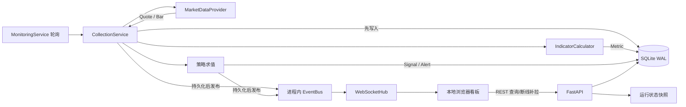

# 系统架构

## 1. 定位与边界

本项目是一个面向个人、本地运行的中国 A 股行情监控骨架，最低支持 Python 3.9。当前默认通过 AShareHub 接入沪深 A 股 HTTP 批量实时快照、未复权日线与证券目录，同时保留 AllTick、AKShare 和可重复的 mock provider；数据统一写入 SQLite，并继续提供技术指标、研究信号、告警、REST API、本地 WebSocket 推送和浏览器看板。

平台只用于数据研究、监控和辅助决策，不连接券商交易柜台，不创建、提交或撤销订单，也不承诺数据完整性、实时性或投资收益。`buy` / `sell` 只是研究信号，不是交易指令。真实资金决策前，应独立核验行情、公司行为、交易状态和交易所规则。

运行时支持 `AShareHubMarketDataProvider`、`AllTickMarketDataProvider`、`AkShareMarketDataProvider` 与 `MockMarketDataProvider`。AShareHub 只有 HTTP 拉取：实时端点一次最多 200 个代码，日线和证券目录使用长缓存；本地按上海自然日持久化请求计数，并在 100 次供应商额度前以 90 次软预算熔断。它不提供官方股票 WebSocket、逐笔、五档盘口或分钟 K 线，本地 `/ws/market` 只转发已采集领域事件。API 读取按当前 provider 的 `source` 隔离；AllTick 的原有 HTTP/WS 能力和 AKShare 兼容源仍可显式启用。

## 2. 组件与职责

| 模块 | 职责 | 不应承担的职责 |
| --- | --- | --- |
| `quant_monitor.domain` | 定义 `Instrument`、`Quote`、`Bar`、`Metric`、`Alert`、`Signal` 和进程内事件；统一证券代码、时区、数值校验 | 厂商字段解析、网络请求、SQL、策略逻辑 |
| `quant_monitor.data_sources` | 定义 `MarketDataProvider`；AShareHub 提供默认 HTTP 快照/日线/目录，AllTick、AKShare 为兼容源，mock 提供可重复离线数据 | 展示、策略判断、跨厂商公共业务规则 |
| `quant_monitor.storage` | SQLite 表结构及读写；对行情、K 线和指标执行幂等 upsert | 拉取数据、计算指标、判断交易规则 |
| `quant_monitor.services.collection` | 分路编排报价/K 线采集；一条链路失败时保留另一条成功数据，持久化、计算指标并发布事件 | 长期调度、HTTP 响应 |
| `quant_monitor.services.indicators` | 无外部依赖的 SMA、EMA、RSI、收益率和波动率等纯计算 | 取数、落库、发单 |
| `quant_monitor.services.analysis` | 组合技术指标、趋势/动量/风险标签和研究偏向；显式报告数据质量 | 下单、风险授权、厂商网络请求 |
| `quant_monitor.services.event_bus` | 单进程异步发布/订阅；隔离一个订阅者的失败 | 跨进程消息、持久化队列、事件重放 |
| `quant_monitor.services.monitoring` | 轮询循环、策略求值、信号去重、错误转告警、内存快照 | Web 路由、厂商认证、订单执行 |
| `quant_monitor.strategies` | 策略契约、注册表和均线交叉示例 | 直接访问厂商 API、数据库或交易柜台 |
| `quant_monitor.runtime` | 组合 provider、repository、服务和 WebSocket hub；维护进程状态 | 通用领域模型或可复用策略计算 |
| `quant_monitor.app` | FastAPI 生命周期、批量沪 A 行情/分析 REST、WebSocket 传输、参数校验和静态文件 | 行情厂商细节、指标算法 |
| `quant_monitor.web` | 本地看板的展示、REST 补拉和 WebSocket 更新 | 作为权威数据源或交易终端 |
| `quant_monitor.config` / `main` | JSON 与环境变量配置、命令行启动 | 保存密钥到公开响应、业务计算 |

领域层使用不可变 dataclass。价格和金额使用 `Decimal`，对外 JSON 中通常序列化为字符串；时间戳必须带时区并归一化为 `Asia/Shanghai`；证券代码使用 `600519.SH`、`000001.SZ`、`430047.BJ` 形式。

## 3. 运行时数据流

一次采集周期的实际顺序如下：

1. 去重并规范化自选证券代码，调用 provider 批量获取最新报价。
2. 以 `(symbol, timestamp)` 为键 upsert 报价，然后逐条发布 `quote` 事件。
3. 如果启用 K 线，调用可覆盖的 `fetch_bars_many`；AShareHub 只支持未复权日线并优先复用 SQLite/24 小时缓存，AllTick 首次逐证券回填后批量合并最新两根，其他 provider 按各自契约执行。
4. 按证券和周期分组本批 K 线，计算当前可用指标；以 `(symbol, name, timestamp)` 为键 upsert，并发布 `metric` 事件。
5. 为每个证券创建 `StrategyContext`，依次调用策略；校验策略名和证券代码后写入信号，再发布 `signal` 事件。策略异常被转换为 `warning` 告警，不中止其他策略。
6. 采集层异常被转换为 `critical` 告警和进程内 `error` 事件；轮询循环记录错误后继续下一周期。
7. `ApplicationRuntime` 订阅全部事件，并以 best-effort 方式广播给每个 WebSocket 客户端。REST 查询主要从 SQLite 读取；系统状态来自监控服务的线程安全内存快照。

应用启动时只初始化数据库、恢复本地缓存并订阅事件，不等待真实 provider 网络响应。AShareHub 报价在监控任务中后台轮询，日线由独立作业按证券逐只获取并立即持久化；中途失败或进程退出不会丢失已完成进度。历史作业保留部分软预算给报价/人工操作，达到保留线后暂停并在预算重置后继续。证券目录刷新同样在后台执行。页面刷新和进程重启不会绕过持久化预算。停止时先通知任务，在有界宽限后取消仍卡住的协程，再关闭 provider 和数据库。

AShareHub 银行目录的“策略最低样本”与“目录完整性”是两个门槛：后者保守要求至少 1,000 条证券、40 只可分类银行且所有记录来源一致，才允许在一个 SQLite 事务内替换目录。未通过时继续使用明确标注的 42 只静态兜底，并保留原目录；不能在 15 只截断样本上生成横截面结论。

## 4. 一致性、并发与故障语义

- SQLite 文件数据库启用 WAL、外键、5 秒 busy timeout 和 `synchronous=NORMAL`，适合单机、单应用进程下看板读与采集写并行；它不是高吞吐分布式时序数据库。
- repository 使用进程内可重入锁保护共享连接。不要让多个独立应用实例同时承担采集主节点；若将来需要多进程，应拆分采集服务、API 服务并引入明确的消息和存储一致性方案。
- 行情、K 线、指标的唯一键支持同一批次重试。当前唯一键不含 `source`，同一证券同一时间来自不同 provider 的记录会相互覆盖；接入多源行情前必须决定权威源或修改模式。
- 告警和信号表使用自增 ID，没有业务唯一约束。策略信号只按 `(strategy, symbol, action, timestamp)` 在当前进程内抑制重复；进程重启或历史重放仍可能生成重复记录。
- EventBus 不是事务消息队列。当前流程通常先落库再发布，因此客户端漏掉事件后可用 REST 补拉；但事件没有游标、确认或重放机制。
- 同一事件的订阅者并发执行，一个订阅者失败会被记录且不妨碍其他订阅者。WebSocket 单次发送超时为 1 秒，失败客户端会被移除。
- `MonitoringService.current_snapshot()` 是进程快照，不是数据库事务快照。API 若需要跨表严格一致的切面，应另行实现读事务或批次 ID。

## 5. 当前存储模型

| 表 | 主键/标识 | 说明 |
| --- | --- | --- |
| `instruments` | `symbol` | 证券静态信息、上市日、最小价位、交易单位及扩展 metadata |
| `quotes` | `symbol, timestamp` | 时点报价；`volume` / `turnover` 的累计口径需由 provider 明确 |
| `bars` | `symbol, interval, timestamp` | OHLCV；AShareHub 收盘日线当前以交易日 15:30 标记保守可用时点，其他源必须在适配器内明确语义；未来 schema 仍需拆分 period/available/received 时间 |
| `metrics` | `symbol, name, timestamp` | 指标值及窗口；周期目前放在 metadata 中 |
| `alerts` | 自增 `id` | 采集或策略异常以及未来监控告警，可确认 |
| `signals` | 自增 `id` | 研究信号及原因，不是订单 |

时间以带 `+08:00` 的 ISO-8601 文本存储。因为模型在入库前归一化为上海时区，当前按文本取最大时间可工作；绕过领域模型写入其他偏移格式会破坏该假设。

默认 AShareHub 配置使用独立文件 `data/quant_monitor_asharehub.db`，避免旧 AllTick/AKShare K 线满足分析窗口后让新 provider 被静默跳过。Windows/POSIX 启动器及默认配置加载器在只覆盖 provider、未显式覆盖数据库路径时，会自动选择 `data/quant_monitor_<provider>.db`；自定义配置文件和显式 `QUANT_MONITOR_DATABASE_PATH` 始终优先。当前唯一键不含 `source`，不能把多个真实源写入同一文件后仍假设分析口径一致。

## 6. A 股市场语义边界

### 6.1 交易日历与交易时段

`quant_monitor.market.market_status()` 当前只把周一至周五视为交易日，标识 09:15–09:25 开盘集合竞价、09:30–11:30 和 13:00–14:57 连续竞价、14:57–15:00 收盘集合竞价。它明确返回 `calendar: "weekday_fallback"`，不能识别法定节假日调休、交易所临时休市、特定证券停牌或产品差异。

接入真实数据前，应导入上交所、深交所、北交所公布的年度休市安排及后续临时通知，并保存“交易所 + 交易日期 + 各时段 + 版本/来源”。周末调休上班日通常也不是交易日，不能套用中国大陆工作日日历。调度器、K 线切分、指标窗口和回测应共享同一份版本化交易日历；不要仅凭本地时钟决定数据是否缺失。

### 6.2 原始价、前复权、后复权与除权除息

实时报价和权威落库基准应保存未经复权的原始价，并单独保存现金分红、送转、配股等公司行为和每日复权因子。前复权通常以最新价格为锚调整历史序列，后复权通常保持较早价格基准并调整后续序列；不同供应商对红利税、配股、因子生效日和精度的处理可能不同，不能混用供应商或把复权价覆盖原始价。

数据契约至少应包含 `adjustment = raw/qfq/hfq`、因子版本、基准日和数据来源。公司行为修订后需要重算受影响的 K 线、指标与信号。除权除息日的参考前收盘价可能由交易所规则重新计算，不能简单拿上一自然记录的收盘价计算涨跌幅或收益率。盘中监控优先使用原始价；研究序列使用哪种复权口径必须显式声明。

### 6.3 停牌与缺失数据

停牌不是价格为零。应保留最后有效成交价，并另存证券级交易状态、状态生效时间、原因和来源；区分全天停牌、盘中临时停牌、未开盘、已收盘、无成交与数据源中断。

停牌时建议默认不制造平盘 K 线，也不前向填充成交量或用填充值计算收益率。若特定研究需要合成 K 线，必须打上 synthetic 标记并确保实时策略可排除。复牌、盘中临停和上市初期的价格约束可能不同，应由当日证券状态驱动，而不是由代码前缀推断。

### 6.4 涨跌停与板块差异

涨跌幅规则必须作为按“交易所、板块、证券类型、风险警示状态、上市阶段、交易日期”版本化的参考数据，而不是写死一个百分比。当前常见股票规则可作为校验起点：沪深主板普通股票通常为 10%，主板风险警示股票通常为 5%；科创板和创业板通常为 20%，其风险警示股票通常仍沿用板块比例；北交所股票通常为 30%。注册制下沪深主板、科创板、创业板首次公开发行上市后的前 5 个交易日通常不设日涨跌幅限制，北交所新股上市首个交易日通常不设日涨跌幅限制，之后才进入相应板块比例。

这些比例不是完整规则。重新上市、退市整理、并购重组后的特定情形、暂停后恢复交易、无价格涨跌幅限制日、基金和可转债等都可能不同；无日涨跌幅限制也不代表不存在有效申报价格范围、价格笼子或盘中临时停牌。涨跌停价还受参考价、最小报价单位和交易所取整规则影响，不能只做浮点乘法。最终判断应消费数据源给出的当日上下限价并用交易所规则交叉验证；规则变更时保留历史版本。

## 7. 实时数据质量要求

领域模型目前只有一个行情时间戳；AShareHub 使用响应中的 `trade_time`，非交易时段可能是上一交易日收盘快照；AllTick 使用逐笔事件时间，AKShare 无可靠交易所时间时使用本机接收时间。`quote_dict()` 按运行时阈值输出 `data_age_seconds` 和 `stale`。生产级接入仍应补充并区分：

- 交易所事件时间、供应商发送时间、本机接收时间和持久化时间；所有时间必须带时区，并监测本机 NTP 偏差。
- 供应商序列号或稳定事件 ID、批次 ID、重连会话和快照/增量标记。
- 完整性、延迟、停滞、缺口、乱序、重复、跨字段一致性和源切换状态。
- 成交量是当日累计股数还是手数、盘口数量单位、成交额币种与口径、K 线时间戳边界及区间闭合约定。

数据库 upsert 能消除“相同键”的重复，却不能识别时间不同但内容相同的重复，也不能阻止旧报价覆盖监控服务的内存最新值。真实 provider 应按序列号/事件时间在适配层去重与拒绝倒退，允许的迟到窗口要按数据类型配置；历史补数可写库，但不应反向触发实时策略。每个周期还应检查请求证券缺失、多条同证券报价、`bid <= ask`、OHLC 关系、累计量回退及异常跳变。

采集器通过 `fetch_bars_many` 允许 provider 原生批量化。AShareHub 在 `X-API-Key` 请求头认证，实时快照按最多 200 个代码合并；免费档 100 次/日，本地默认 90 次软预算且跨重启持久化，跨进程锁保证“读取—递增—写回”原子化，手工冒烟与主服务按密钥哈希身份共用同一预算（预算文件不保存明文密钥）。认证/参数/额度错误不重试，默认网络重试也为 0，避免一次操作在用户不知情时重复计费。日线原始 `vol`（手）和 `amount`（千元）进入领域模型前分别转换为股和元。所有 provider 的异常、日志和状态都不得包含密钥、认证头或完整敏感响应。

行情授权同样是架构约束。本地使用不自动取得抓取、缓存、历史留存、衍生计算或再分发许可。接入前应核对供应商和交易所的数据许可证、终端数量、展示范围、留存期限和审计要求；API 密钥只能放在环境变量或本地密钥存储中，不能进入仓库、日志、`public_config`、WebSocket 消息或浏览器代码。默认服务绑定 `127.0.0.1`；改为局域网/公网监听前必须增加认证、TLS、访问控制和数据授权评估。

## 8. 演进方向

### 8.1 当前交易日历契约

`quant_monitor.trading_calendar.TradingCalendar` 是市场状态、日线质量审计和离线回测共用的纯函数契约，提供交易日判断、前后会话、区间会话及 15:30 日线发布边界。默认 `WeekdayFallbackCalendar` 仍只是周一至周五近似规则，元数据固定标记 `verified=false`。

`VersionedSessionCalendar` 可接收有序、唯一的离线日期集合并保留调用方声明的 `source`、`version` 和 `identifier`，用于可复现实验及节假日测试。它是有限覆盖日历：所有日期和区间查询只要越过首末覆盖日就抛出 `CalendarRangeError`，不能把覆盖外的“未知”静默解释成休市或截断到已有日期。但这些字符串不构成来源认证，该实现同样固定为 `verified=false`，不能声称已经接入官方交易所日历。当前市场状态、质量审计和回测还会强制对外报告 `calendar_verified=false`，不会信任任意结构化 `TradingCalendar` 实现传入的真值。未来的正式实现应由受控导入流程核验交易所公告、覆盖范围和内容版本，并引入独立的认证证据，而不是允许业务调用方自行把标志设为真。

日线质量审计除了按日历计算缺失窗口，还会单独报告 `off_calendar_date_count` / `off_calendar_dates`。非会话日 K 线不会计入可用历史，并至少把该证券标为 `warning`、整体结果降级，避免完整窗口掩盖周末或休市日的异常记录。

推荐按以下顺序扩展：

1. 接入一家具备合法授权的真实 provider，同时建立原始响应留样、字段映射和数据质量门禁。
2. 引入官方交易日历、证券主数据、当日交易状态、上下限价和公司行为/复权因子。
3. 为数据增加事件时间/接收时间、序列号、质量标记、复权口径和批次血缘，解决乱序与补数语义。
4. 将策略配置化并建立同口径回放/回测，验证无未来函数、停牌与涨跌停可交易性。
5. 数据量超过单机 SQLite 能力后，再拆分采集、时序存储和 API；保持领域契约和“先持久化、后通知”的恢复路径。

即使未来增加交易执行，也应作为独立、默认关闭且需要人工确认的受控子系统设计，不应让监控信号直接穿透到券商订单接口。
